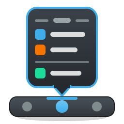
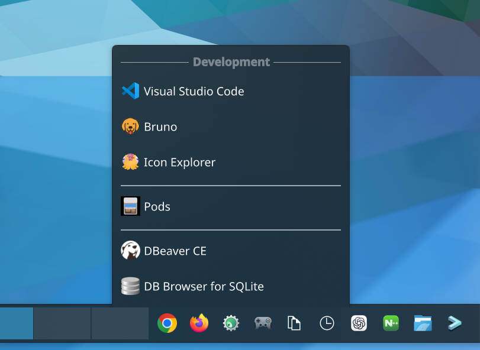
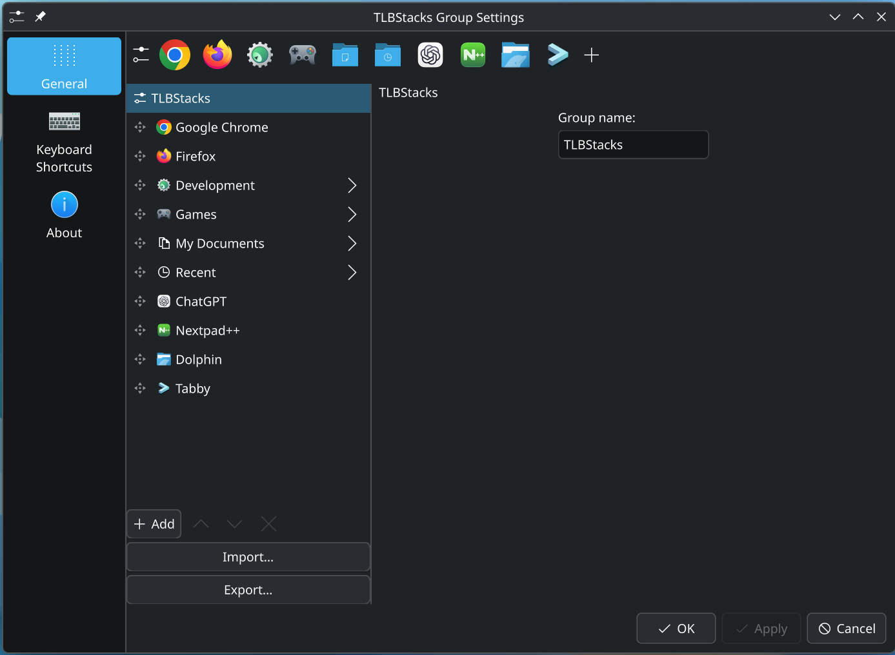
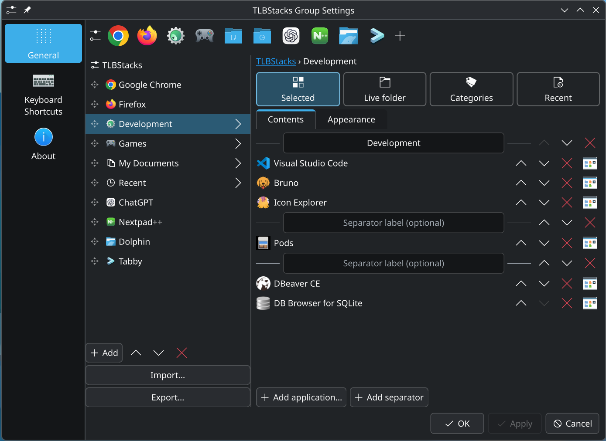
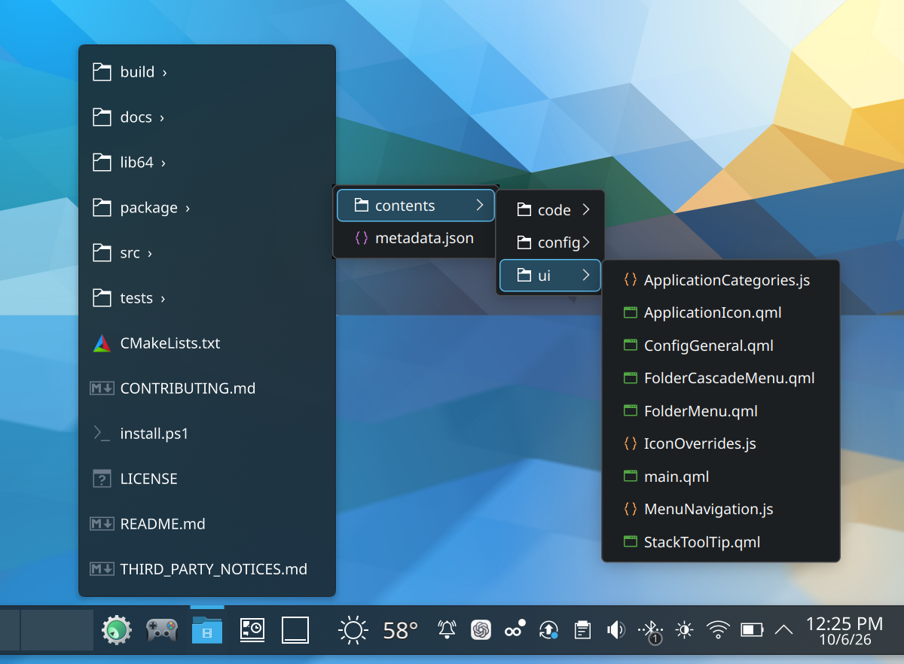
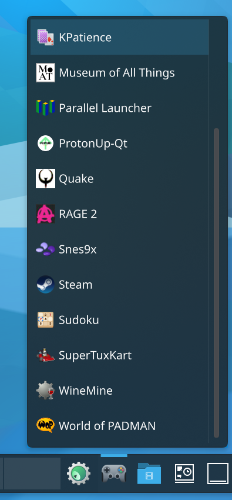
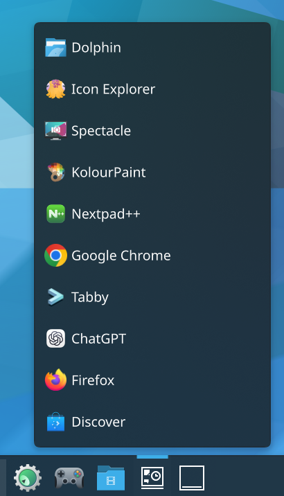
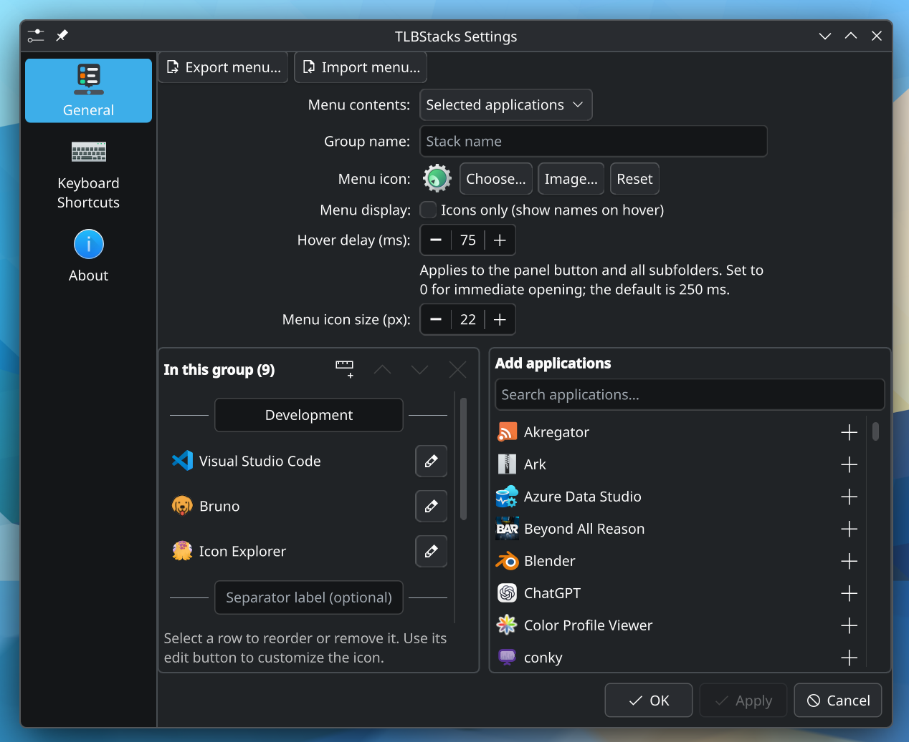

<h1>&nbsp;TLBStacks</h1>

**Application launchers, configurable stacks, live menus, and task management for KDE Plasma 6.**

**TLBStacks Groups** is the main widget: one launcher bar containing individual
application launchers, any mixture of stacks, and — enabled by default —
running-window management, so it can replace a separate task manager widget
entirely. It is a different option from Plasma's **Icons Only Task Manager**,
not a companion to it: launchers merge with their own windows, and windows of
applications outside the group appear in an append zone while they run.
Prefer a pure launcher bar or your existing task manager? Task tracking can be
switched off per group.

The standalone **TLBStacks** widget remains available when you want a single
stack on the panel without the rest.

A TLBStacks Group can combine entries such as:

- individual application launchers
- manually selected application stacks
- application-category stacks
- recent or frequently used application stacks
- live folder stacks

Each stack behaves the same way whether it is used by itself or inside a group.
See [Running windows](#running-windows) below for the task management details.

Inspired by the original Windows True Launch Bar, TLBStacks is an independent
Linux project for KDE Plasma 6. It is not affiliated with TORDEX or the original
True Launch Bar.

<!-- NEW HERO IMAGE:
     Suggested filename: docs/images/group-hero.png
     TLBStacks Groups launcher bar containing individual application launchers
     and several stacks, with one stack open.
-->
<p align="center">
  
</p>

<p align="center">
  <sub>TLBStacks Groups with individual launchers and several stacks. The open Development stack contains selected applications and separators.</sub>
</p>

## What it does

### TLBStacks Groups

**TLBStacks Groups** is the primary widget: a launcher bar built from
individual applications, TLBStacks menus, and — by default — running-window
management, positioned as an alternative to a separate task manager widget.

A group can contain any mixture of:

- **Application launchers:** launch an application directly from the panel.
  The displayed label and icon can be customized.
- **TLBStacks:** add any of the stack types described below.
- Multiple copies of the same stack type with independent configuration.

Items can be reordered within the group, and the entire group configuration can
be exported or imported.

With task tracking enabled (the default), a group can also show and switch
running windows; see [Running windows](#running-windows) below.

### Running windows

TLBStacks Groups can show and switch running windows, so a single launcher bar
can replace a separate task manager widget. Task tracking is enabled by default
and can be turned off per group with **Show running windows (task tracking)**
in the group configuration; the group then behaves as a pure launcher again.

- **Configured launchers merge with their windows:** an application launcher
  shows its own running windows instead of a duplicate task button: a running
  indicator appears, along with the window count when the application has
  several windows. A stack button shows a dimmed indicator while any of its
  member applications runs.
- **Append zone:** applications that are not part of the group appear as extra
  buttons while they run and disappear again once their last window closes.
  Windows without an installed desktop entry keep their window title and icon.
  Custom command launchers and application launchers with arguments never claim
  windows, so their windows show up in
  the append zone too.
- Application launchers with arguments always run their configured command, even
  when the application is already running. Clearing the arguments restores normal
  task-button behavior.
- **Click matrix:** left-click an idle application to launch it, a running one
  to activate its most recent window, and a focused one to minimize it —
  except when it has several windows, where the click cycles to its next
  window instead. Middle-click a running application to open a new window.
  Scrolling the wheel over a button steps through that application's windows.
- **Hover window tiles:** hover a running application to see each of its
  windows as a live thumbnail. Click a thumbnail to activate exactly that
  window; middle-click it, or use its close button, to close exactly that
  window. Minimized windows show the application icon instead of a live
  preview.
- **Running state in stacks:** stack menus show a running dot beside entries
  whose application is running, highlighted while active. Clicking a running
  entry activates its window instead of launching a new copy; middle-clicking
  it opens another window. A standalone TLBStacks button shows the same dot
  while any of its member applications runs.

Task tracking uses Plasma's taskmanager QML module. Wherever that module is
missing, TLBStacks degrades gracefully: the widget still loads and works as a
pure launcher, without running indicators or window switching.

### Stack types

Every stack type can be used either as a standalone TLBStacks widget or as an
item inside TLBStacks Groups.

- **Selected Applications:** build an ordered list of installed applications.
  Applications can be reordered, given custom icons, and separated with named
  or unnamed separators.
- **Application Categories:** automatically populate a stack from one or more
  desktop-entry categories. Categories are searchable and can be combined.
- **Recent / Frequent Applications:** automatically populate a stack using
  KDE-recorded application usage. Choose either most recently used or most
  frequently used applications, optionally filter by application categories,
  and optionally restrict results to the current Activity.
- **Live Folder:** display the contents of a local folder as a live menu.
  Subfolders open as cascading menus, filenames can be filtered with patterns,
  and files can be moved to Trash directly from the menu.

### Menu behavior and appearance

- **Custom appearance:** customize launcher and stack icons, menu icon size,
  labels, and other presentation options.
- **Cascading menus:** browse nested Live Folder contents without leaving the
  launcher hierarchy.
- **Separators:** Selected Applications stacks support both plain separators
  and titled sections.
- **Mouse and keyboard navigation:** navigate menus with the mouse or arrow keys,
  activate entries with Enter, and dismiss menus with Escape.
- **Hover opening:** stacks can open by click or after a configurable hover delay.
- **Portable configuration:** export and import standalone stacks or an entire
  TLBStacks Group, including custom icon images.

## Security and architecture

Why does a launcher widget ship a compiled C++ plugin? Because everything that
makes TLBStacks more than a list of buttons lives in APIs that QML cannot reach
on its own: Plasma's task manager model (per-window activate, minimize, cycle,
close and live window state — the same interfaces the stock task manager uses),
KDE's application launch service, and the activity/usage statistics that power
Recent and Frequent stacks. The plugin (`src/`, a few small files) is exactly
that bridge — nothing more:

- it runs as your user, inside plasmashell; there is no daemon, no root or
  setuid component, and no background service
- it opens no network connections (the only network in the project is the
  build service fetching the release tag)
- custom launchers execute through `QProcess::startDetached` with an argument
  vector — no shell is ever involved, so no configuration string can inject
  commands, and every target is verified (absolute path, regular file,
  executable bit) before it runs
- importing a profile executes nothing; profiles never bundle executables,
  and every custom command is visible in the editor before it can be used
- user-controlled names are escaped at every rendered binding (tested)

Builds are transparent: the RPM and debs are produced by the [openSUSE Build
Service](https://build.opensuse.org/project/show/home:mattisking:tlbstacks)
from a release tag of this repository — not compiled on a random machine —
served over HTTPS and signed with the project's OBS key. Verify the key
fingerprint on the project page when you add the repository.

See [SECURITY.md](SECURITY.md) for the full security notes, with the code
references behind each claim.

## Two ways to use TLBStacks

### Standalone TLBStacks

Add a TLBStacks widget directly to a Plasma panel when you want a single stack
without the rest of a group.

Standalone stacks support the same Selected Applications, Application Categories,
Recent / Frequent Applications, and Live Folder content sources available inside
TLBStacks Groups.

### TLBStacks Groups

Add a TLBStacks Groups widget when you want one launcher bar containing multiple
stacks and individual application launchers.

Stacks inside a group provide the same content sources and menu behavior as
standalone TLBStacks widgets.

## Screenshots

### TLBStacks Groups

<!-- NEW IMAGE:
     Suggested filename: docs/images/group-hero.png
-->
<p align="center">
  
</p>

### Group configuration

<!-- NEW IMAGE:
     Suggested filename: docs/images/group-editor.png
     Top-level TLBStacks Groups editor showing the launcher bar preview,
     ordered group items, and Import/Export controls.
-->
<p align="center">
  
</p>

A group is an ordered collection of launchers and stacks. Items can be reordered,
edited individually, added or removed, and exported together as one configuration.

### Editing a stack inside a group

<!-- NEW IMAGE:
     Suggested filename: docs/images/group-selected-editor.png
     Selected Applications editor inside TLBStacks Groups.
-->
<p align="center">
  
</p>

Stacks embedded in a group use the same configuration and behavior as standalone
TLBStacks widgets. Selected Applications supports application ordering, custom
icons, and named or unnamed separators.

### Live Folder

<p align="center">
  
</p>

### Application Categories and Recent / Frequent

<table align="center">
  <tr>
    <td align="center">
      <br>
      <sub>Application Categories</sub>
    </td>
    <td align="center">
      <br>
      <sub>Recent / Frequent</sub>
    </td>
  </tr>
</table>

### Standalone stack configuration

<p align="center">
  
</p>

## Project status

Early development, tested primarily on Fedora with KDE Plasma and Wayland.
Other distributions may work, but installation paths and dependencies vary.
Screen-edge, scaling, and multi-monitor coverage is still incomplete; see
[testing and known verification gaps](docs/TESTING_AND_STATUS.md).

Releases are published on
[the releases page](https://github.com/mattisking/tlb-stacks/releases):
each tag builds and tests the widget in CI and attaches a source tarball, a
prebuilt Fedora package tree, and the Plasma widget payload.

TLBStacks includes a compiled C++ plugin, so it cannot be installed through
Plasma's "Get New Widgets" dialog. Build from the source tarball, or install a
distribution package.

Planned work is tracked in the
[feature tracker](docs/FEATURE_TRACKER.md); historical True Launch Bar features
are research material, not promises about this project.

## Installing

Packages are built automatically from every release tag and published on
the [openSUSE Build Service](https://build.opensuse.org/project/show/home:mattisking:tlbstacks).
When adding the repository, verify the OBS key fingerprint on the project page
against the key you import. See [Security notes](SECURITY.md) for what the
compiled backend does and does not do.

### Fedora 44

```sh
sudo dnf config-manager addrepo --from-repofile=https://download.opensuse.org/repositories/home:/mattisking:/tlbstacks/Fedora_44/home:mattisking:tlbstacks.repo
sudo dnf install tlbstacks
```

### Ubuntu with Plasma 6 (26.04, 25.10, 25.04, 24.10)

For each release line (example: 26.04):

```sh
echo 'deb https://download.opensuse.org/repositories/home:/mattisking:/tlbstacks/xUbuntu_26.04/ /' | sudo tee /etc/apt/sources.list.d/tlbstacks.list
curl -fsSL "https://download.opensuse.org/repositories/home:/mattisking:/tlbstacks/xUbuntu_26.04/Release.key" | gpg --dearmor | sudo tee /etc/apt/trusted.gpg.d/tlbstacks.gpg > /dev/null
sudo apt update
sudo apt install tlbstacks
```

### Other distributions

Build from the source tarball, or install a distribution package built
from it. You need KDE Plasma 6, Qt 6 and KDE Frameworks 6 runtime
libraries, and Python 3.

## Getting started

You need KDE Plasma 6, a C++20 compiler, CMake, Qt 6 and KDE Frameworks 6
development libraries, Python 3, and PowerShell for the supplied installer.

1. Clone this repository:

   ```text
   git clone https://github.com/mattisking/tlb-stacks.git
   ```

2. Follow [Build and install](docs/DEPLOYMENT.md), including its prerequisites.

3. Add either **TLBStacks** or **TLBStacks Groups** through Plasma's widget picker.

   - Use **TLBStacks** for a single standalone stack.
   - Use **TLBStacks Groups** for a launcher bar containing individual
     application launchers and multiple stacks.

The installer builds a native QML module as well as installing the widget
package. By default it restarts Plasma; review the deployment instructions first.

If you used the earlier project name, follow the
[one-time migration instructions](docs/DEPLOYMENT.md#renaming-existing-installations).

## Documentation and contributions

- [Project guide](docs/README.md): documentation index and maintenance conventions.
- [Entry model and navigation](docs/STACK_ENTRY_MODEL.md): current architecture.
- [Feature tracker](docs/FEATURE_TRACKER.md): requested and deferred work.
- [Contributing](CONTRIBUTING.md): bug reports, changes, and verification.
- [Issues](https://github.com/mattisking/tlb-stacks/issues): report a problem or propose an improvement.

## License and attribution

Copyright © 2026 Matt Philmon and contributors.

TLBStacks original source code and project-authored documentation are licensed
under the **GNU General Public License, version 3 or (at your option) any later
version** (`GPL-3.0-or-later`). See [LICENSE](LICENSE). The software is provided
without warranty.

See [third-party notices](THIRD_PARTY_NOTICES.md) for the historical manual and
dependencies. TLBStacks is not affiliated with TORDEX or the original True Launch Bar.
